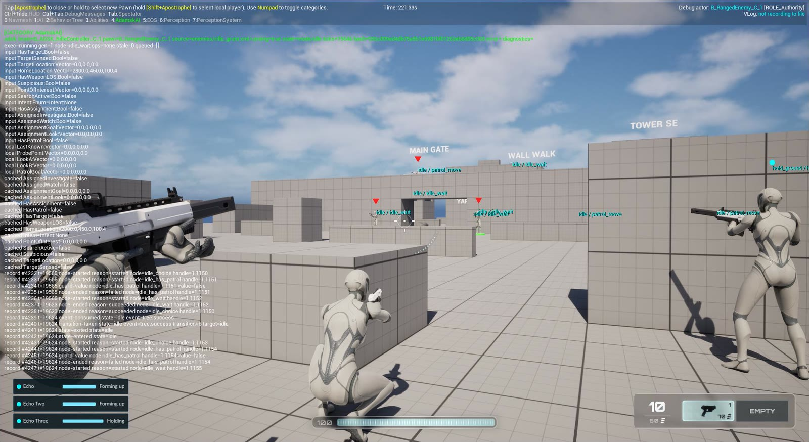
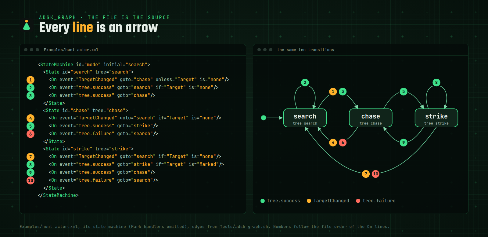
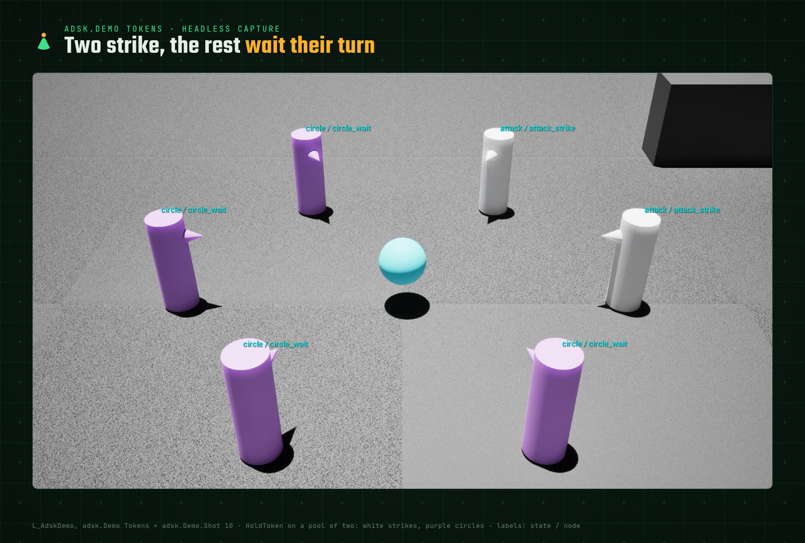
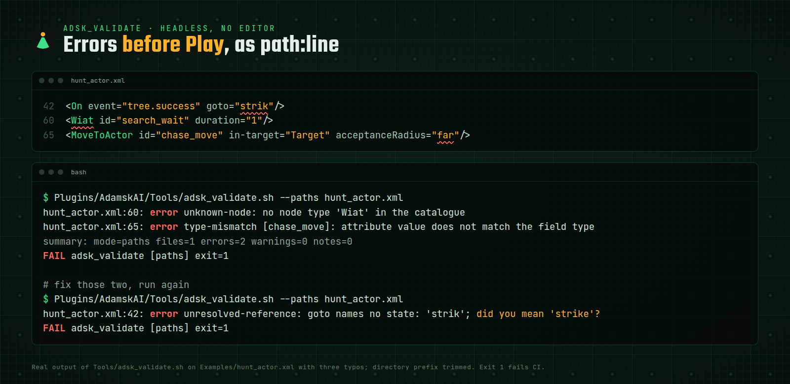
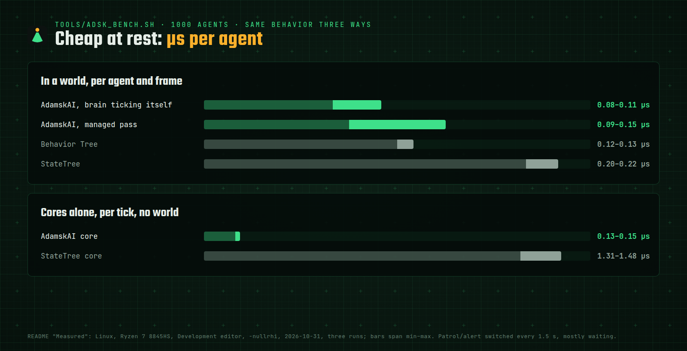

<h1 align="center"></h1>

<p align="center"><b>Agent behavior for Unreal Engine 5.6–5.8, written as text.</b></p>

<p align="center">
  <a href="LICENSE"></a>
  
  
  
</p>

<p align="center"></p>

A statechart of modes with a behavior tree in each, authored in strict XML, checked headlessly before the game runs,
reloaded while it plays and replayed exactly from a seed.

- **Behavior is text.** It diffs, goes through review, merges, and a coding agent can write it from the node catalogue.
- **Errors before Play.** A strict compiler and a headless validator report typos, unknown nodes, type mismatches,
  holds and livelocks as `path:line` diagnostics, in a CI with no renderer.
- **Exact replay.** Randomness is seeded per agent; a run replays from its seed, inputs and events in the same
  build, with a bounded trace ([limitations](docs/limitations.md)).
- **Live reload.** Save the XML while playing and every agent keeps the state it was in.
- **Cheap at rest.** A brain that waits or walks sleeps until its wait ends or its move reports, like a Behavior Tree;
  1000 brains cost about 0.1 ms per frame ([Measured](#measured)). A brain with `OnPreTick` bound or sensors in
  its file never sleeps; publish such facts with `SetInput` when they change, which wakes it.

Version 0.5.0, beta: XML v1 is stable, the C++ API may still change. Changes: [CHANGELOG.md](CHANGELOG.md); upgrading:
[docs/migration.md](docs/migration.md); known gaps: [docs/limitations.md](docs/limitations.md).

## What a behavior looks like

Modes are states that change on events; each leaf state runs a tree that ends in success or failure. The host
publishes facts (`Target`); the file decides. An excerpt of [Examples/hunt_actor.xml](Examples/hunt_actor.xml):

```xml
<StateMachine id="mode" initial="search">
  <!-- Look around; a target appearing starts the chase at once. -->
  <State id="search" tree="search">
    <On event="TargetChanged" goto="chase" unless="Target" is="none"/>
    <On event="tree.success" goto="search" if="Target" is="none"/>
    <On event="tree.success" goto="chase"/>
  </State>
  <!-- Run at the actor; losing it searches again. -->
  <State id="chase" tree="chase">
    <On event="TargetChanged" goto="search" if="Target" is="none"/>
    <On event="tree.success" goto="strike"/>
    <On event="tree.failure" goto="search"/>
  </State>
  ...
</StateMachine>

<Tree id="chase">
  <FocusActor id="chase_face" in-target="Target">
    <MoveToActor id="chase_move" in-target="Target" acceptanceRadius="100"/>
  </FocusActor>
</Tree>
```

<p align="center"></p>

To see it run, open `Plugins/AdamskAI Content/Demo/Maps/L_AdskDemo` (Content Browser, *Show Plugin Content*), press
Play and type `adsk.Demo Chase`. Seven scenes cover patrols, interrupts, squad calls, attack tokens, live reload and a
1000-brain fleet with its cost on screen: [docs/demo.md](docs/demo.md).

<p align="center"></p>

## Quick start

1. Put the plugin at `Plugins/AdamskAI` in your project and enable `AdamskAI` in the `.uproject`: either
   `git clone https://github.com/RazielSun/AdamskAI.git Plugins/AdamskAI` (or a submodule) to follow the repository,
   or, from a clone elsewhere, `Tools/adsk_export.sh --out <Project>/Plugins/AdamskAI` for only what a project needs
   ([setup](docs/setup.md#getting-the-plugin)).
2. Add `AdamskAI` and `AdamskAIHost` to your game module's dependencies.
3. Give your `AAIController` a `UADSKBrainComponent`, call `InitializeFromSource(TEXT("guard.xml"))`, publish the
   file's required inputs with `SetInput`, then `StartLogic()` once and `TickBrain(DeltaTime)` every controller tick.
4. Write `Content/AI/guard.xml`, starting from [Examples/](Examples/README.md).
5. Build the editor, then check everything headlessly:
   `Plugins/AdamskAI/Tools/adsk_all.sh` (Windows: `Tools\adsk_all_win64.ps1`).

<p align="center"></p>

The whole setup, with the controller pattern: [docs/setup.md](docs/setup.md). Project nodes come from an
`IADSKNodeProvider` in your module: [docs/authoring-nodes.md](docs/authoring-nodes.md).

## AdamskAI, Behavior Tree or StateTree?

| | AdamskAI | Behavior Tree | StateTree |
|---|---|---|---|
| Authored as | XML text | graph asset | graph asset |
| Structure | statechart of modes, a tree per leaf mode | one tree | states with tasks |
| Data | typed Inputs and Locals; events carry typed parameters | Blackboard | property bindings |
| Reacting to a change | `change` events, `ReactiveSelector`, `OnCheck` | decorator aborts | transitions |
| Concurrency | `Parallel` with success and failure policies, `SimpleParallel`, scopes | Simple Parallel | parallel tasks in a state |
| Resume the mode it left | `history` | in code | in code |
| Checked | compiler and validator, headless: references, types, holds, livelocks | in the editor | in the editor |
| Debugging | deterministic replay, bounded trace, `adsk_simulate` scenarios | Visual Logger, BT debugger | Rewind Debugger |
| Reload | XML while playing; native nodes need a restart | asset edit | asset edit |
| Nodes in | C++ only, by design | C++ or Blueprint | C++ or Blueprint |

**Where they are better.** Behavior Trees and StateTree have a visual editor and Blueprint nodes, are supported by
Epic and plug into Mass, Smart Objects and Gameplay Interactions. AdamskAI has no graph editor (`adsk_graph` draws a
read-only diagram), no parallel regions in the state machine and no montage node yet.

Pick AdamskAI when behavior should live in text, be tested like code and replay exactly. Feature by feature and
pattern by pattern, also against BehaviorTree.CPP, py_trees, HFSM2 and SCXML: [docs/comparison.md](docs/comparison.md).

## Measured

<p align="center"></p>

One behavior written three ways and run side by side (`Tools/adsk_bench.sh`): patrol (wait 1 s, wait 1 s) and alert
(wait 0.25 s twice), switched by a host flag that flips every 1.5 s per agent, so about 14,000 branch entries in
every system. 1000 agents over bare controllers, 600 frames, three runs. Linux, AMD Ryzen 7 8845HS, Development
editor, `-nullrhi`, 2026-10-31.

| Per agent and frame | µs |
|---|---|
| AdamskAI, brain ticking itself | 0.08–0.11 |
| AdamskAI, managed pass | 0.09–0.15 |
| Behavior Tree (`RunBehaviorTree`, Blackboard decorator aborting both ways) | 0.12–0.13 |
| StateTree (StateTree component, event transitions, engine Delay) | 0.20–0.22 |

The cores alone, ticked every frame with no world: AdamskAI 0.13–0.15 µs per tick, StateTree 1.31–1.48 µs. This
behavior is mostly waiting, which is where sleeping pays; a behavior reacting to a value that changes every frame is
not measured yet.

| AdamskAI on its own | Result |
|---|---|
| Demo fleet, 1000 brains on the managed pass (Linux) | 0.13 ms per frame with recorders, 0.10 ms on workers without |
| 200 agents walking with `MoveTo` (Linux) | 0.038 ms per frame for the brains |
| Core tick, every frame (Win64) | 0.20 µs per agent with a 256-record recorder, 0.17 µs without |
| `Start` / `Stop` (Win64) | 0.47 µs / 0.11 µs |
| Compile a 200-line file (Win64) | 0.35 ms, once per file, shared by every agent |
| Memory (Win64) | 6.8 KB per instance plus its node memory, allocated up front |

Methods, every benchmark, ceilings and how to profile your own project: [docs/dev/perf.md](docs/dev/perf.md).

## Documentation

| To | Read |
|---|---|
| Deploy it into a project | [setup](docs/setup.md), then [Linux](docs/linux.md) or [Windows](docs/windows.md) |
| Write behavior | [XML reference](docs/xml-reference.md), [node catalogue](docs/node-catalog.md), [style](docs/xml-style.md), [Examples](Examples/README.md) |
| Do a whole task (new NPC, a fact or event, a project node, porting a BT or StateTree) | [recipes](docs/recipes/README.md) |
| Understand the design and the guarantees | [concept](docs/concept.md), [semantics](docs/semantics.md), [runtime contract](docs/contract.md) |
| Reload, debug, network | [reload](docs/reload.md), [debugging](docs/debugging.md), [networking](docs/networking.md) |
| Avoid surprises | [gotchas](docs/gotchas.md), [limitations](docs/limitations.md), [glossary](docs/glossary.md) |
| Work on the plugin | [testing](docs/dev/testing.md), [performance](docs/dev/perf.md), [roadmap](docs/dev/roadmap.md), [CONTRIBUTING](CONTRIBUTING.md) |

**Coding agents** start at [AGENTS.md](AGENTS.md). In a project that uses the plugin, add a line to the project's own
`AGENTS.md` / `CLAUDE.md` pointing at `Plugins/AdamskAI/AGENTS.md` so they find it.

## Status

Verified on Linux with UE 5.8.4: the build, the plugin alone in an empty project, about 650 automation tests and 60
world tests; the same on Win64 with MSVC 14.51 in three host projects, plus Development and Shipping game builds and
the cook check, a packaged run with brains loading from the pak and a packaged listen server. One source builds and
passes every test on UE 5.6.1 and 5.7.4 too (Win64; 5.6.1 also on Linux). Android (UE 5.8.4, built on Win64): the
plugin and a game for arm64 and x64, and an APK whose brains run on an emulator. Mac is not built. What is left:
[docs/dev/roadmap.md](docs/dev/roadmap.md).

## License

MIT, see [LICENSE](LICENSE). Issues and pull requests: [CONTRIBUTING.md](CONTRIBUTING.md).
