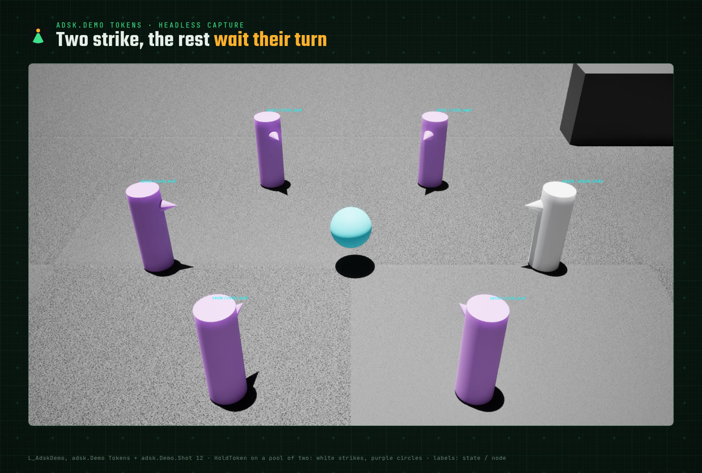

# Demo

A map and console scenes that show what AdamskAI does, with nothing but engine shapes: no animation, no input
bindings, no UI. Every scene is also a headless test (`AdamskAIWorld.Demo.*`), so it keeps working as the plugin
changes, and the Fleet scene writes the performance numbers this page quotes.

<p align="center"></p>

## Run it

1. In the editor's Content Browser, enable **Settings → Show Plugin Content** and open
   `Plugins/AdamskAI Content/Demo/Maps/L_AdskDemo`.
2. Press Play (PIE), open the console (`` ` ``) and type `adsk.Demo Patrol`. `adsk.Demo.List` names every scene;
   `adsk.Demo.Clear` removes what a scene spawned.

Agents are cylinders with a cone for a nose, tinted by their state: green on watch or patrol, red chasing or
attacking, yellow searching or investigating, purple circling, white while an `Act` runs. The sphere is the stand-in
for the player; `adsk.Demo.Target stop` and `go` halt and resume it. Each agent's label shows `state / node`
(`adsk.Labels`, on in every scene but large fleets), and the Gameplay Debugger's `AdamskAI` category (`'`) shows a
selected agent's inputs, locals and trace.

The scenes spawn at fixed arena positions; in another level with a navmesh they should run too, but only the arena
is tested.

## Scenes

| Scene | What to watch | File |
|---|---|---|
| `Patrol` | three guards share a square, each from another corner; a fourth stands a timed watch at the post, scanning at random, and walks back | [patrol.xml](../Demo/patrol.xml), [post.xml](../Demo/post.xml) |
| `Chase` | a guard that sees the sphere (a `LineOfSight` sensor) chases it, keeps where it was last seen with `Set`, strikes when close, searches that place when the sphere slips away, then walks its beat again | [chase.xml](../Demo/chase.xml) |
| `Interrupt` | one tree, a `ReactiveSelector` of three options: a close, seen target makes the agent back off home facing it; a 5 s `Cooldown` interrupts the patrol for a shout the moment it is ready. The label's node switches without the state changing | [interrupt.xml](../Demo/interrupt.xml) |
| `Squad` | four guards at posts in one group; the first to see the sphere radios `Contact` with where (`Radio` with a `Param`); the others go there half a second later and look around | [squad.xml](../Demo/squad.xml) |
| `Tokens` | six attackers around a still target; `HoldToken` on a pool of two lets two strike at a time while the others circle. The on-screen line counts the strikers | [tokens.xml](../Demo/tokens.xml) |
| `Reload` | the Chase scene, run from a copy of its file under `Saved/AdamskAI/DemoEdit/` (the hint prints the path). Edit the copy while it plays (a wait, a radius, a whole state): the editor reloads it and every agent keeps the state it was in. `adsk.Reload` forces it | [chase.xml](../Demo/chase.xml) |
| `Fleet` | 500 brains of core nodes on the managed tick, with their cost on screen | [fleet.xml](../Demo/fleet.xml) |

## Fleet

`adsk.Demo.Fleet <count> [lod] [parallel] [norecorder] [color]` starts the Fleet scene with that many brains (up to
10,000) and those settings; Clear puts the project's settings back.

| Option | What it changes |
|---|---|
| `lod` | `TickLOD`: brains farther than 10 m from the viewer tick every 0.2 s, farther than 20 m every 0.5 s |
| `parallel` | `bParallelManagedTick`: the file is core nodes only, so its brains tick on worker threads |
| `norecorder` | no trace recorder per brain, which is what Shipping costs |
| `color` | tints a tenth of the dots by state each frame; costs more than the brains themselves |

The line on screen gives the managed pass's time per frame, µs per brain tick, ticks per brain per frame and the
share on workers. Measured by the tests on Linux, Development editor, `-nullrhi`, 2026-10-31:

| Test | Brains | Brain pass per frame | Ticks per brain per frame |
|---|---|---|---|
| `AdamskAIWorld.Demo.Fleet` (recorders on) | 1000 | 0.13 ms | 0.07 |
| `AdamskAIWorld.Demo.FleetParallel` (workers, no recorders) | 1000 | 0.10 ms | 0.07 |

Brains sleep through their waits (`bSleepWhenIdle`, the default), so each ticks about once in fifteen frames; with it
off every brain ticks every frame and the pass costs 0.40 ms and 0.23 ms.

Both write `Saved/AdamskAI/perf/<test>.json`. The pass includes the managed ticker's own bookkeeping; the core alone
is in [perf.md](dev/perf.md).

## Screenshots

Two commands make a scene's picture reproducible, in the editor or from a headless game:

| Command | What it does |
|---|---|
| `adsk.Demo.Camera overview\|top` | views the arena from a fixed camera: at an angle from the south, or straight down |
| `adsk.Demo.Camera <x> <y> <z> <pitch> <yaw> [fov]` | the same from any place, centimetres and degrees; `fov` is horizontal, default 90 |
| `adsk.Demo.Shot <seconds> [name] [clean] [quit]` | a screenshot that many game seconds from now, to `Saved/Screenshots/<Platform>/AdamskAI/<name>.png` (default name: the scene's). `clean` hides the demo's on-screen text but keeps the labels; `quit` exits once the file is on disk |

One scene, one process, about fifteen seconds on Linux with no window:

```bash
UnrealEditor <Project>.uproject /AdamskAI/Demo/Maps/L_AdskDemo -game -RenderOffscreen -ForceRes -resx=1920 -resy=1080 \
  -unattended -nosplash -nopause \
  "-ExecCmds=adsk.Demo Tokens, adsk.Demo.Camera 0 -1000 750 -35 90 55, adsk.Demo.Shot 12 tokens clean quit"
```

The log line `adsk.Demo.Shot: wrote <path>` names the file; without it after 20 s the command logs an error and, with
`quit`, exits anyway. A shot taken earlier with the same name is deleted first, so a stale picture never passes.

## How it is built

- Module `AdamskAIDemo` (Runtime, not built for Shipping or Test): `Engine`, `AIModule`, `NavigationSystem`,
  `Projects`, `AdamskAI`, `AdamskAIHost`. The actors are `AADSKDemoAgent` (a character), `AADSKDemoController` (owns
  the brain, performs `Act` as a flash), `AADSKDemoTarget` and `AADSKDemoDot`; `UADSKDemoSubsystem` holds the scenes
  and the commands.
- The behavior files are in [Demo/](../Demo/), mounted as `@AdskDemo` when the module starts; `adsk_validate` and
  `adsk_schema_check` check them with the examples.
- The arena is generated, not drawn: `AdamskAIWorld.Demo.Content` with `ADSK_GENERATE_DEMO_MAP=1` writes
  `Content/Demo/Maps/L_AdskDemo` from `ADSKDemoLayout` (floor, walls, cover, the post marker, a dynamic navmesh). Run
  it again after changing the layout or moving to another engine version.
- The demo is for the editor and PIE. A packaged build has the module outside Shipping, but `Demo/` is not staged.

## Tests

`Plugins/AdamskAI/Tools/adsk_test.sh AdamskAIWorld.Demo` runs every scene headless and checks what it promises:
every patrol leg walked, a chase that ends in a search when the target vanishes, a cooldown and a close target
interrupting the patrol, a squad that leaves its posts after one sighting, never more than two strikers, a reload
that keeps the agents' states, and the fleet's numbers.
